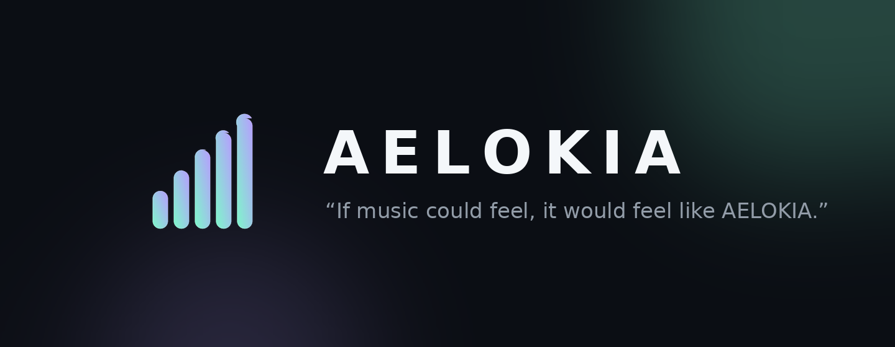

<div align="center">



<h1>Aelokia</h1>

**Simple Android YouTube Music client with Material UI, Liquid Glass, Bit-Perfect playback, Automix, Lossless addons & advanced audiophile features.**

</div>

---


## Overview

Aelokia is a fast, native YouTube Music client for Android that looks great and sounds even better. Built with Material 3 Expressive and Liquid Glass UI, it gives you a clean, fluid design that adapts to your music.

For audio lovers, Aelokia packs Bit-Perfect USB DAC output, Lossless FLAC addon support, AutoEQ headphone presets with parametric EQ, smooth Automix transitions, Spotify Canvas & integration, and real-time synced lyrics, all in a lightweight app.

---


## Features

<table>
  <tr>
    <td width="50%" valign="top">

#### Playback
- Stream any track or video from YouTube Music
- Background playback with lockscreen & Android Auto controls
- High-res audio downloads with embedded tags & `.lrc` lyrics
- Download & cache for offline listening
- Skip silence & sleep timer

</td>
    <td width="50%" valign="top">

#### Audio
- Bit-Perfect USB DAC output (direct hardware bypass)
- Lossless FLAC addon support (up to 24-bit Hi-Res)
- 15-band Parametric Equalizer & AutoEQ headphone presets
- Smart Automix transitions & smooth crossfade
- Audio normalization (ReplayGain / LUFS)
- Real-time tempo & pitch control

</td>
  </tr>
  <tr>
    <td width="50%" valign="top">

#### Lyrics & Discovery
- Live millisecond-synchronized lyrics (LRCLIB)
- Lyrics romanization for non-Latin scripts (Japanese, Korean, etc.)
- Multi-language lyrics translation
- Spotify Canvas & animated video backgrounds (Apple Music & Tidal)
- Personalized quick picks, mood radios & genre discovery
- Search songs, albums, artists, videos, and playlists

</td>
    <td width="50%" valign="top">

#### Library & Account
- Full library management & offline cached library
- Spotify Integration (Account login, Liked Songs sync & deep links)
- Import public playlists from Spotify & Apple Music
- YouTube Music account login & bidirectional sync
- Local & cloud playlists with custom reordering
- Custom audio tag editing & cover art selection

</td>
  </tr>
  <tr>
    <td width="50%" valign="top">

#### Social
- Listen together with friends in real-time
- Built-in Last.fm scrobbler with background tracking
- Safe Discord Rich Presence with live album art
- Export and share lyrics as aesthetic quote cards

</td>
    <td width="50%" valign="top">

#### Interface
- Material 3 Expressive & Liquid Glass UI
- Real-time backdrop refraction shaders
- Dynamic Monet theming + 19 preset color palettes
- Light, Dark, Pure Black (AMOLED), and Dynamic modes
- Interactive home screen widgets & fluid tactile haptics

</td>
  </tr>
</table>

---


## Getting Started

### Installation

[](https://github.com/trigxon/Aelokia/releases/download/5.2.1/Aelokia-universal-v5.2.1.apk)

**[⬇ Aelokia v5.2.1 — Universal APK](https://github.com/trigxon/Aelokia/releases/download/5.2.1/Aelokia-universal-v5.2.1.apk)** — **the recommended build for most devices** (Android 10+). R8-optimized, works on all modern phones and tablets.

**Other variants** (same app, different packaging — see the [release page](https://github.com/trigxon/Aelokia/releases/tag/5.2.1) for details):
1. **[Universal](https://github.com/trigxon/Aelokia/releases/download/5.2.1/Aelokia-universal-v5.2.1.apk)** — Android 10+ · recommended · smallest download with full optimizations
2. **[Universal Uncompressed](https://github.com/trigxon/Aelokia/releases/download/5.2.1/Aelokia-v5.2.1-universal-uncompressed.apk)** — Android 10+ · raw unminified build for debugging and custom firmware
3. **[Android 7 Legacy](https://github.com/trigxon/Aelokia/releases/download/5.2.1/Aelokia-v5.2.1-android7.apk)** — Android 7.0 – 9.0 · compressed native libraries for older package managers
4. **[vivo Origin](https://github.com/trigxon/Aelokia/releases/download/5.2.1/Aelokia-v5.2.1-vivo-origin.apk)** — vivo OriginOS only · allowlisted package for Origin Island & music widget

### Quick Setup

1. Install the APK on your Android device.
2. *(Optional)* Navigate to **Settings → Audio** to configure:
   - **Bit-Perfect Output:** Enable exclusive USB DAC mode for bit-perfect audio.
   - **AutoEQ Presets:** Search for your headphones/IEMs to apply calibrated parametric EQ curves.
   - **Lossless Addons:** Enable the modular addon service for 24-bit Hi-Res FLAC playback.
3. Start streaming music, listening to customized radios, and enjoying synced lyrics!

---

## Building from Source

### Prerequisites
- **JDK:** OpenJDK 17 or higher
- **Android SDK:** API Level 34+ with CMake & Android NDK installed (for native audio C++ engine & USB driver)

### Build Instructions

```bash
# Clone the repository
git clone https://github.com/trigxon/Aelokia.git
cd Aelokia

# Build the release APK
./gradlew assembleRelease

# The generated APK will be at:
# app/build/outputs/apk/release/app-release-unsigned.apk
```

> [!TIP]
> For local development and debugging, run `./gradlew assembleDebug` or install directly to a connected device via `./gradlew installDebug`.

---

## Support the Project

If Aelokia has been useful to you, consider supporting its development.

<div align="left">
  <table style="margin: 0 auto; border-collapse: collapse; border: none;">
    <tr>
      <td align="center" style="padding: 15px; border: none;">
        <a href="https://buymeacoffee.com/5073340abdw" target="_blank" style="text-decoration:none;"></a>
      </td>      <td align="center" style="padding: 15px; border: none;">
        <a href="https://github.com/sponsors/trigxon" target="_blank" style="text-decoration:none;"></a>
      </td>
    </tr>
  </table>
</div>


---


## Acknowledgements

Aelokia is made possible thanks to these open-source projects:

- **[Metrolist](https://github.com/MetrolistGroup/Metrolist)** — InnerTubeX & stream resolving
- **[SimpMusic](https://github.com/maxrave-dev/SimpMusic)** — Canvas extraction & Liquid Glass inspiration
- **[InnerTune](https://github.com/z-huang/InnerTune)** — InnerTube extraction architecture
- **[Decent USB Audio Driver](https://github.com/silva96/decent-usb-audio-driver)** — Bit-perfect direct USB DAC audio engine
- **[AutoEQ](https://github.com/jaakkopasanen/AutoEq)** — Headphone & IEM frequency-response calibration targets
- **[NewPipe](https://github.com/TeamNewPipe/NewPipeExtractor)** — Stream extraction & media URL resolving
- **[SponsorBlock](https://sponsor.ajay.app/)** — Video segment detection for music video intro skit synchronization
- **[LRCLIB](https://lrclib.net/)** — Real-time millisecond-synchronized lyrics database
- **[Kyant](https://github.com/kyant0)** — Jetpack Compose backdrop refraction & shape shaders

---

## Disclaimer

Aelokia is an open-source, non-commercial application developed strictly for educational and research purposes.

- **No Affiliation:** This project is not affiliated with, funded, authorized, endorsed by, or in any way associated with Google LLC, YouTube, YouTube Music, Spotify, Apple Inc., Last.fm, or any of their subsidiaries.
- **Content Delivery:** Aelokia does not host, store on private servers, or distribute copyrighted media. All playback streams and metadata are resolved directly from public endpoints.
- **Trademarks:** All product names, logos, trademarks, and registered trademarks belong to their respective owners.
